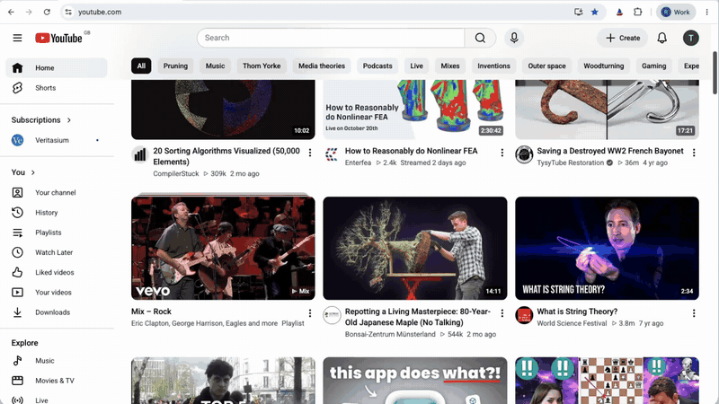

# Digital Habits: Focus

> Formerly known as ReDD Focus, Viking Focus or MindShield.

  

Digital Habits: Focus is a browser extension that makes distracting websites less distracting. It can hide the feeds, recommendations and other parts of a site that pull your attention away, turn a site greyscale, add a delay before it opens, or redirect it somewhere else. It helps people use YouTube, Instagram, LinkedIn and other sites for what they came to do. It works in Safari on Mac, iPhone and iPad, and in Chrome, Edge and Firefox.

It is made by the not-for-profit [Centre for Digital Habits](https://digitalhabits.org) and [backed by research](https://arxiv.org/pdf/2001.04180.pdf) at the universities of Oxford, Copenhagen and Maastricht.

<!-- Badges: each store's own artwork, saved at 120px tall and shown at 60
     (Chrome's a little bigger, as its white frame makes it look smaller). -->

> [!NOTE]
> On iPhone and iPad, the extension changes how sites look in Safari. It cannot change the apps. To change apps on Android, for example to make them easier to handle with ADHD, use our sister app [Digital Habits: Focus for Android](https://play.google.com/store/apps/details?id=net.kollnig.greasemilkyway) on Google Play.

## Demo

## What the extension does

The extension makes it easier to control your time & attention online, by letting you:
- hide distracting elements, like algorithmic feeds, Shorts, or comments, with ready-made options for YouTube, Facebook, X, Instagram, LinkedIn, Reddit, Google Search and WhatsApp Web
- hide custom elements on any website
- make a website greyscale, so it is less tempting
- add a delay before a website opens, with a message that asks what you came to do
- redirect a website to somewhere else
- lock your settings, so changing them takes a short wait

## How it works

Click the Focus icon in your browser's toolbar to see the options for the website you are on. Tick the parts you want to hide, or turn on Greyscale, Delay or Redirect.

To hide anything else, click **Pick…** and click the part of the page you want gone. Before anything is hidden, you can make the area larger or smaller, or move to the part beside it, then click **Hide**. On a computer, the arrow keys do this too: up and down for larger and smaller, left and right for the part beside it. You can give each hidden part a name, and show it again from the popup at any time.

Your choices are kept per website. To try something for one visit only, turn off **Auto-save changes to hidden elements** in Settings.

## Privacy

Digital Habits: Focus:
- runs entirely in your browser
- does not require an account
- does not collect personal data, the sites you visit or your settings
- keeps your settings in your browser's own storage

In Chrome, Edge and Safari, it sends one anonymous count a day, with an ID that changes every month, so we know how many people use it. You can turn this off in Settings, under Admin. Firefox sends no count.

## Documentation

- General project overview: this README
- Release notes: [`changelog.md`](changelog.md)
- Built-in options for each site: [`Shared (Extension)/Resources/selectors.js`](Shared%20(Extension)/Resources/selectors.js)
- Security: [`SECURITY.md`](SECURITY.md)

## Development

The extension's code is in [`Shared (Extension)/Resources`](Shared%20(Extension)/Resources). The same files are used in every browser.

- **Safari (Mac, iPhone, iPad):** open `Digital Habits Focus.xcodeproj` in Xcode and click **Run**.
- **Chrome or Edge:** open `chrome://extensions`, turn on Developer mode, click **Load unpacked** and choose `Shared (Extension)/Resources`.
- **Firefox:** open `about:debugging#/runtime/this-firefox`, click **Load Temporary Add-on…** and choose `Shared (Extension)/Resources/manifest.json`.

## Contributing

Contributions are welcome.

Websites change their pages often, and the built-in options then stop working. If you want to fix or add one:
1. Find the option in [`selectors.js`](Shared%20(Extension)/Resources/selectors.js).
2. Test the change on the website, logged in and logged out, on a computer and on a phone if you can.
3. Submit a pull request that says which part of the page the change affects.

You can also report a bug or suggest an idea in [Issues](https://github.com/digitalhabits/dh-focus/issues), or email [team@digitalhabits.org](mailto:team@digitalhabits.org).
